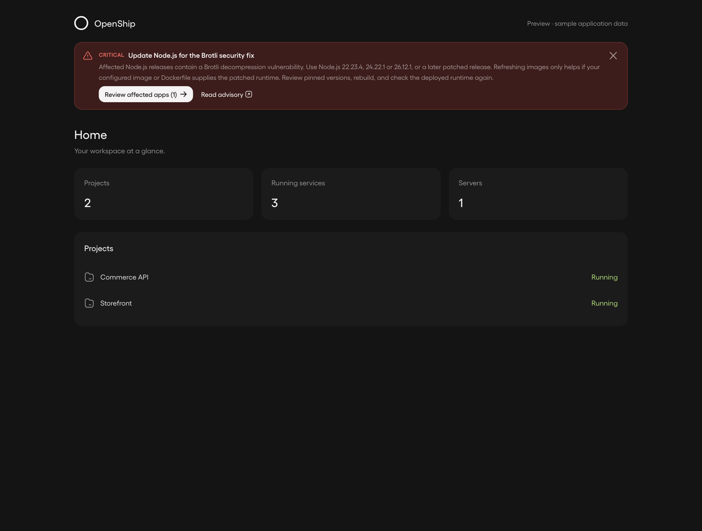

# Runtime security notice

These screenshots render the existing root `UpdateCenter` banner and its runtime
security review dialog with the dashboard's Gellix font and dim theme. The Home
page contains sample application data;
the notice uses the public Node.js advisory and a synthetic affected runtime.
They are UI evidence, not proof that a live application was scanned or patched.



[Mobile banner](advisory-found-mobile.png) · [Review dialog](advisory-review.png) ·
[Mobile review](advisory-review-mobile.png) · [Browser checks](browser-checks.json)

The additional Cloud fixtures show [a required Node 20 major upgrade](runtime-upgrade-required.png)
and [the saved banner preference in Settings](banner-settings.png). They use the same
components with Cloud deployment metadata and an observed `node 20.20.2` finding marked
`runtimeUpgradeRequired`. [Additional browser checks](banner-preference-browser-checks.json)
cover the configuration action, mobile overflow, hiding critical banners, reload
persistence and restoring visibility without deployment or policy writes.

The [workspace check setting](checks-disabled-settings.png) shows inspection disabled
with banner visibility still enabled. It uses the real Settings component, light theme
and synthetic API responses; no production settings were changed.

Run the dashboard development server, then:

```sh
node scripts/screenshots/security-advisories/capture.mjs
```

Set `SCREENSHOT_ORIGIN` if it is not at `http://localhost:3001`, and
`PLAYWRIGHT_MODULE` to an installed Playwright entry point if needed.
The script temporarily creates a development-only page and always removes it.
It runs in an isolated browser context and intercepts every API request: it never
uses a real login, sends a notification or deploys a project. Consent changes and
the Apply action only exercise the real browser handlers against fixture responses.
